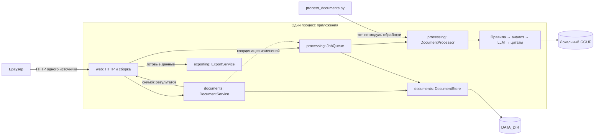

# System Design

Приложение принимает эпикризы в Markdown, извлекает 50 строковых полей в 9 группах, связывает значения с исходным текстом и выгружает JSON или XLSX. Его основные модули соответствуют этапам работы: `documents` → `processing` → `exporting`. Они выполняются в одном процессе приложения; взаимодействие между ними — обычные вызовы Python.

## Компоненты и зависимости



Стрелка CLI показывает использование того же кода: консольная команда работает отдельным процессом и создаёт собственный `DocumentProcessor`.

`documents` владеет приёмом, чтением, удалением и хранением документов. `processing` владеет выбором незавершённых документов, очередью и извлечением данных. `exporting` превращает готовый снимок результатов в файл. `web` связывает эти операции с HTTP, cookie и представлением цитат для браузера. `shared` содержит общие настройки, схему полей, валидацию и файловые операции.

Границы выражены в интерфейсах, а не только в каталогах:

- `DocumentService` зависит от протокола `SessionCoordinator` с `lock`, `busy()` и `reset()`. Его реализует `JobQueue`; модуль документов не импортирует конкретную очередь.
- `JobQueue` обращается к хранилищу через его операции. Отчёт сохраняется вызовом `save_batch_report()`, без знания файлового пути.
- `DocumentProcessor` принимает текст и возвращает `Extraction(result, evidence, report)`. Он не знает о сессиях, Flask и расположении файлов.
- `DocumentService.results_snapshot()` читает результаты под блокировкой. `ExportService` формирует выгрузку из этого снимка после освобождения блокировки.
- `DocumentService.source()` возвращает текст и evidence. HTTP-адаптер `citation_view.py` переводит координаты цитат в UTF-16.

`web/application.py:create_app()` собирает зависимости. Очередь `app.extensions["jobs"]` общая для приложения; сервис документов создаётся для текущей сессии. HTTP и консольные входы используют публичные API модулей. Карта файлов — в [описании модулей](modules.md).

## Загрузка и обработка новой партии

До записи проверяется вся партия: допустимость текста, размеры, ZIP и имена. Совпадающие имена получают суффикс, например `case_1.md`; исходный документ не перезаписывается. Повторная загрузка того же содержимого создаёт отдельный документ — дедупликации по хешу нет.

`JobQueue.start()` читает актуальный список хранилища и выбирает только документы с `processed=false`. Память очереди хранит прогресс, а готовность определяется сохранёнными результатами.

```mermaid
sequenceDiagram
    participant UI as Браузер
    participant API as HTTP API
    participant Docs as DocumentService
    participant Store as DocumentStore
    participant Queue as JobQueue
    participant Worker as Фоновый worker
    participant Processor as DocumentProcessor

    Note over UI,Store: A готов; пользователь добавляет B
    UI->>API: POST /upload: B.md
    API->>Docs: upload(files)
    Docs->>Queue: Проверить занятость под общим lock
    Docs->>Store: Проверить и сохранить B
    Docs->>Queue: reset(session)
    API-->>UI: accepted: [B.md]
    UI->>API: POST /process
    API->>Queue: start(session, store)
    Queue->>Store: list()
    Store-->>Queue: A: processed=true, B: processed=false
    Queue->>Worker: Партия [B]
    Queue-->>API: total=1, skipped=1
    API-->>UI: 202 Accepted
    Worker->>Processor: process(B, citations=true)
    Processor-->>Worker: result, evidence, report
    Worker->>Store: Сохранить комплект B
    loop Пока задача активна
        UI->>API: GET /process/status
        API->>Queue: status(session)
        Queue-->>API: Снимок прогресса
        API-->>UI: Состояние задачи
    end
    Note over Store: Комплект A не изменяется
```

Ошибка одного документа добавляется в `errors`, обработка остальных продолжается. Незавершённый комплект удаляется, поэтому следующий запуск повторяет только документы без готового результата. Изменение правил или модели само по себе не пересчитывает готовые документы: для нового результата документ можно удалить и загрузить заново.

Если всё готово, сервер возвращает HTTP 200 с `status=done`, `total=0`, `skipped=N`, `completed=0`, `succeeded=0`. Модель не подготавливается, worker не запускается, файлы и предыдущий отчёт партии не меняются. Пустая сессия возвращает 400; новая партия и повторное обращение к активной задаче — 202.

## Состояние и конкурентный доступ

| Статус | Значение |
|---|---|
| `idle` | В памяти нет задачи: до запуска, после изменения набора документов или перезапуска приложения |
| `queued` | Партия ждёт единственный worker |
| `running` | Worker выполняет партию |
| `done` | Все попытки завершились либо новых документов нет; отдельные ошибки могут оставаться в `errors` |
| `failed` | Ошибка самой задачи, например отказ executor или запись отчёта партии |

`total` — число документов текущей партии; `skipped` — число уже готовых. `completed` учитывает все завершённые попытки, `succeeded` — сохранённые результаты. `current` содержит текущий документ, `first` — первый успешный результат этой партии. Полный контракт — в [HTTP API](api.md).

Повторный запуск занятой сессии возвращает ту же задачу с тем же `id`. Загрузка и удаление в ней запрещены до завершения и возвращают 409. Проверка занятости, изменение документов и сброс прогресса выполняются под общей блокировкой. Снимки статуса глубоко копируются, чтобы вызывающий код не мог менять внутренние ошибки и предупреждения.

Обычный запуск использует один процесс Waitress с 8 потоками HTTP и `ThreadPoolExecutor(max_workers=1)` для обработки. Партии всех сессий выполняются последовательно. Блокировка очереди согласует состояние и файловые операции; длительный инференс выполняется вне неё. `LocalModel` имеет собственный lock для загрузки весов и обращения к `llama_cpp`.

## Хранение и совместимость

```text
DATA_DIR/
├── .secret
└── <session-id>/
    ├── uploads/
    │   ├── case.md
    │   └── case.ev.md
    ├── results/
    │   ├── case.md/
    │   │   ├── result.json
    │   │   ├── evidence.json
    │   │   └── report.json
    │   └── case.ev.md/
    │       ├── result.json
    │       ├── evidence.json
    │       └── report.json
    └── batch-report.json
```

Результаты каждого документа находятся в каталоге с его полным именем, включая `.md`. Имена `case.ev.md` и `case.report.md` не конфликтуют с цитатами и отчётами `case.md`; новый каталог для `case.json.md` отделён от старого плоского `case.json`.

Хранилище записывает evidence, report, затем result. Каждый JSON сохраняется через временный файл и `os.replace()`. Основной результат публикуется последним, а готовность нового комплекта требует всех трёх файлов. Это последовательность отдельных атомарных замен, а не транзакция базы данных. Незавершённый комплект остаётся необработанным и очищается перед повтором.

Старый плоский формат `case.json`, `case.ev.json`, `case.report.json` читается на месте. Для готовности нужны все три файла, корректная схема результата, структура отчёта и совпадение значений результата с evidence. Это исключает принятие файла цитат за чужой результат или результата за отчёт. При удалении старых артефактов общий путь сохраняется, пока на него ссылается другой документ сессии. При наличии нового каталога готовность определяется по нему.

При обновлении сохраняйте `DATA_DIR` и `SECRET_KEY` либо `.secret`. Конвертация полных старых комплектов не нужна: прежняя сессия продолжит их видеть, а очередь пропустит их. Неполный старый комплект при следующем запуске создаётся заново в новом формате. Переименование консольной команды в `process_documents.py` не меняет расположение данных.

`batch-report.json` описывает последнюю реально выполненную партию: время, успешные записи, ошибки и статистику. Новая загрузка или удаление убирает этот отчёт и сбрасывает прогресс, сохраняя готовые результаты остальных документов. Экспорт `all` включает все готовые документы сессии независимо от партии.

## Конвейер извлечения

1. `rules` разбирает текст и извлекает значения с контекстом и уверенностью; `normalization.py` приводит их к контракту полей.
2. `analysis` находит пропуски и сомнительные связи между признаками. Это эвристики, а не обученная статистическая модель.
3. При включённой LLM `inference` перечитывает выбранные поля и принимает допустимые изменения. При недопустимом ответе сохраняется значение правил с предупреждением.
4. Перекрёстные проверки согласуют связанные поля, затем проверяется полная схема результата.
5. По запросу `citations` находит точные подтверждающие фрагменты. Сбой модельного поиска цитат сохраняет поля и цитаты правил с предупреждением.

Чистый результат содержит только 50 полей. Evidence и отчёт хранятся отдельно. Координаты evidence — индексы символов Python, а HTTP-представление цитат использует UTF-16 для JavaScript. `verified` означает точное совпадение фрагмента с исходником, а не медицинскую экспертизу значения.

## Восстановление и эксплуатация

Очередь и прогресс находятся в памяти. После перезапуска прежние `id`, ошибки и позиции в очереди теряются, статус становится `idle`. Автоматического возобновления нет: повторный запуск выбирает незавершённые документы по файловому хранилищу. Уже сохранённые комплекты остаются доступны даже после сбоя посередине партии.

Несколько серверных процессов над одним `DATA_DIR` не поддерживаются: у каждого собственная очередь и блокировка. Нет отмены задач, автоматических повторов, глобальной квоты диска и срока хранения сессий. Лимиты загрузки: 2 МиБ на документ, 64 МиБ на HTTP-запрос, отдельный ZIP и распакованные тексты партии, 1000 документов на сессию, 5000 записей в ZIP. Проверка партии и формирование экспорта используют память процесса.

Браузер обращается к API одного источника. Подписанная cookie изолирует каталоги сессий; она имеет `HttpOnly` и `SameSite=Strict`. Изменяющие запросы с чужим `Origin` отклоняются. Ключ подписи берётся из `SECRET_KEY` или постоянного `DATA_DIR/.secret`.

Документы и модель обрабатываются на машине приложения: `LocalModel` не вызывает облачные API. Файлы на диске не шифруются приложением; учётных записей, ролей и аудита доступа нет. По умолчанию сервер слушает `127.0.0.1`. Общий сетевой доступ потребует отдельной аутентификации, TLS и правил хранения данных.

## Возможное выделение worker

Текущая система остаётся единым приложением. Если понадобится независимое масштабирование обработки, естественная граница — `JobQueue` → `DocumentProcessor`. Для её переноса между процессами потребуются постоянное хранилище заданий и прогресса, очередь с подтверждением/возвратом потерянных задач, общее хранилище документов и согласованная публикация комплектов.

Повторная доставка должна быть безопасной: ключ обработки включает владельца, содержимое документа, версию схемы/конвейера, модель и значимые настройки. Несколько worker должны согласовывать владение задачей и публикацию результата. Брокер, отдельный сетевой сервис инференса и распределённая координация сейчас не реализованы.
