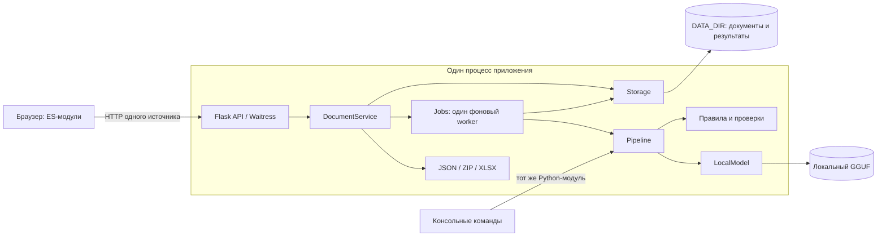
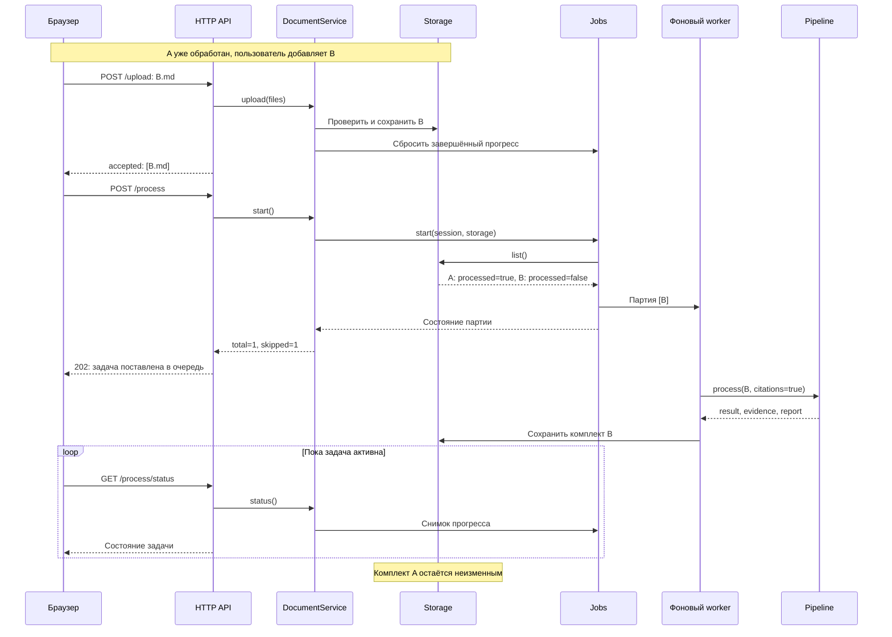

# System Design

Приложение принимает эпикризы в Markdown, извлекает 50 строковых полей в 9 группах, связывает значения с фрагментами исходного текста и выгружает результаты в JSON или XLSX. Веб-интерфейс и консольные команды используют один конвейер извлечения.

## Компоненты и границы

Система устроена как модульный монолит: HTTP API, прикладной сервис документов, хранилище и фоновая обработка имеют отдельные обязанности, но работают в одном процессе. Это позволяет переиспользовать конвейер без сетевых вызовов между модулями и держать один экземпляр локальной модели в памяти.



Связь CLI с `Pipeline` показывает повторное использование кода: консольная команда запускается отдельным процессом и создаёт собственный экземпляр конвейера.

| Граница | Ответственность |
|---|---|
| HTTP API | Разобрать запрос, определить сессию, вызвать сервис, сформировать ответ |
| `DocumentService` | Координировать загрузку, удаление, запуск, чтение и экспорт; запрещать изменение документов занятой сессии |
| `Storage` | Проверить имена, сохранить исходники и комплект результата, определить готовность документа |
| `Jobs` | Выбрать необработанные документы, поставить партию в очередь, выполнить её и сообщать прогресс |
| `Pipeline` | Преобразовать текст в поля, цитаты и отчёт независимо от Flask и файлового хранилища |
| `LocalModel` | Загрузить локальные веса и выполнить запрос с ограниченным JSON-контрактом |

Фабрика `create_app()` собирает зависимости. Сервис создаётся для текущей сессии, а очередь `app.extensions["jobs"]` общая для всего экземпляра приложения. Маршруты не меняют внутреннее состояние очереди напрямую.

## Загрузка и повторная обработка

Загрузка проверяет всю партию до записи документов: допустимость текста, размер, ZIP и имена. Совпадающие имена получают суффикс, например `case_1.md`; старый документ не перезаписывается. Новый файл с тем же содержимым считается отдельным документом: дедупликации по содержимому нет.

Для каждого запуска `Jobs.start()` получает актуальный список из `Storage.list()` и выбирает только записи с `processed=false`. Память очереди не является источником истины о готовности документов.



Ошибка одного документа попадает в `errors`, а обработка остальных продолжается. Комплект неуспешного документа удаляется, поэтому следующий запуск повторяет его. Уже сохранённые результаты пропускаются. Изменение модели или правил само по себе не пересчитывает готовые документы; для нового результата документ можно удалить и загрузить заново.

Если все документы готовы, сервер возвращает HTTP 200 с `status=done`, `total=0`, `skipped=N`, `completed=0`, `succeeded=0`. Модель не подготавливается, worker не запускается, файлы результатов и предыдущий отчёт партии не меняются. Пустая сессия возвращает ошибку 400. Запуск новой партии или повторное обращение к уже активной задаче возвращает 202.

## Состояние задачи

| Статус | Значение |
|---|---|
| `idle` | В памяти нет задачи этой сессии; так бывает до запуска, после загрузки/удаления и после перезапуска приложения |
| `queued` | Партия ждёт единственный worker |
| `running` | Worker обрабатывает партию |
| `done` | Обработка каждого документа партии завершилась либо новых документов нет; отдельные ошибки могут присутствовать в `errors` |
| `failed` | Не удалось выполнить задачу целиком, например поставить её в executor или записать отчёт партии |

`total` — число документов, выбранных в эту партию; `skipped` — число уже готовых документов. `completed` считает все завершённые попытки, включая неуспешные; `succeeded` — сохранённые результаты. `current` содержит имя обрабатываемого документа, `first` — первый успешно обработанный документ текущей партии.

Повторный запуск занятой сессии возвращает ту же задачу с тем же `id`. Загрузка и удаление в этой сессии возвращают 409 до завершения задачи. Статус отдаётся глубокой копией: вызывающий код не может изменить внутренние списки ошибок и предупреждений.

## Хранение и совместимость

```text
DATA_DIR/
├── .secret
└── <session-id>/
    ├── uploads/
    │   ├── case.md
    │   └── case.ev.md
    ├── results/
    │   ├── case.md/
    │   │   ├── result.json
    │   │   ├── evidence.json
    │   │   └── report.json
    │   └── case.ev.md/
    │       ├── result.json
    │       ├── evidence.json
    │       └── report.json
    └── batch-report.json
```

Каждый документ имеет собственный каталог артефактов с полным именем, включая `.md`. Поэтому имена `case.md`, `case.ev.md` и `case.report.md` не конфликтуют с файлами цитат и отчётов. Каталог результата для `case.json.md` также отделён от старого плоского файла `case.json`.

`Storage.save()` последовательно записывает цитаты, отчёт и основной результат. Каждая запись проходит через временный файл и `os.replace()`. Основной `result.json` записывается последним; готовность нового комплекта требует наличия всех трёх файлов. Это порядок фиксации результата на файловой системе, а не транзакция базы данных. Незавершённый комплект остаётся необработанным и очищается перед следующей попыткой.

Поддерживается чтение старого плоского формата `case.json`, `case.ev.json`, `case.report.json`. Для признания такого результата готовым нужны все три файла, корректная схема полей, структура отчёта и совпадение значений полей с соответствующими значениями в цитатах. Проверка не позволяет принять старый файл цитат за результат другого документа или результат за отчёт. При удалении старых артефактов общие пути сохраняются, пока на них ссылается другой документ сессии; это защищает результаты с коллизией имён. Если новый каталог уже существует, готовность определяется по нему. Полные старые комплекты читаются на месте; новые результаты записываются в каталоги документов.

При обновлении сохраняйте прежний `DATA_DIR` и `SECRET_KEY` либо файл `.secret`. Конвертация полных старых комплектов не требуется: они доступны через прежнюю сессию и не попадают в новую очередь. Неполный старый комплект остаётся необработанным и при следующем запуске создаётся заново в новом формате.

`batch-report.json` содержит время, записи, ошибки и статистику последней реально запущенной партии, а не всех документов сессии. Успешная загрузка новых файлов или удаление документа убирает этот отчёт как устаревший. Готовые результаты остальных документов при этом сохраняются. Экспорт всех результатов включает все готовые документы сессии независимо от партии.

## Конвейер извлечения

1. `extraction.regex` разбирает текст и извлекает значения с контекстом и уверенностью.
2. `review.normalize_hits()` приводит значения к контракту полей.
3. `statistics.analyze()` и `consistency` выбирают пропуски и сомнительные поля для дополнительной проверки.
4. При включённой LLM локальная модель перечитывает выбранные поля. `review.apply_review()` принимает только допустимые изменения, сохраняет исходные значения при ошибочном ответе и формирует предупреждения.
5. Перекрёстные проверки согласуют связанные поля, затем `validate_result()` проверяет итоговую схему.
6. По запросу строятся цитаты. Для каждого подтверждения сохраняется исходный фрагмент и его координаты; ошибка модельного поиска цитат позволяет сохранить поля и цитаты правил с предупреждением.

`Pipeline.process()` возвращает `Extraction(result, evidence, report)`. Чистый JSON содержит только поля. Цитаты и служебные метрики хранятся отдельно. В файле цитат координаты заданы индексами символов Python; API переводит их в UTF-16 для подсветки в JavaScript. `verified` означает совпадение фрагмента с исходным текстом, а не медицинскую экспертизу значения.

## Процессы, восстановление и ограничения

Стандартный запуск — один процесс Waitress с 8 потоками HTTP и `ThreadPoolExecutor(max_workers=1)` для обработки. Один worker последовательно выполняет партии всех сессий. `Jobs.lock` согласует изменения состояния и файловые операции; длительный инференс проходит вне этого lock. У `LocalModel` есть собственный lock для загрузки модели и вызова `llama_cpp`.

Очередь и прогресс находятся в памяти. После перезапуска прежние `id`, ошибки и позиции в очереди теряются, статус становится `idle`; автоматического возобновления нет. Исходники и готовые комплекты остаются на диске, поэтому повторный запуск выбирает только незавершённые документы. Это также верно, если сбой случился после сохранения части партии.

Развёртывание нескольких процессов над одним `DATA_DIR` не поддерживается: у каждого будет собственная очередь и блокировка. В текущей реализации нет отмены задачи, автоматических повторов, глобальной квоты диска и срока хранения сессий. Ограничения загрузки: 2 МиБ на документ, 64 МиБ на HTTP-запрос и распакованные тексты партии, 1000 документов на сессию, 5000 записей на ZIP. Партия при проверке размещается в памяти; экспорт также формируется в памяти.

## Граница доступа к данным

Браузер работает с API одного источника. Сессия определяется подписанной cookie; файлы разделены каталогами по идентификатору сессии. Cookie имеет `HttpOnly` и `SameSite=Strict`, а изменяющие запросы с чужим `Origin` отклоняются. Ключ подписи берётся из `SECRET_KEY` либо сохраняется в `DATA_DIR/.secret`; для доступа через прежние cookie его нужно сохранять между запусками.

Текст документов, результаты и веса модели остаются на машине приложения: реализация `LocalModel` не вызывает облачные API. Приложение не шифрует файлы на диске и не предоставляет учётных записей, ролей или аудита доступа. По умолчанию оно слушает `127.0.0.1`. Сетевое развёртывание с общим доступом потребует отдельной аутентификации, TLS и правил хранения данных; готовой конфигурации такого развёртывания в проекте нет.

## Переход к отдельному worker

Первой границей для выделения отдельного процесса является `Jobs` → `Pipeline`: HTTP-слой уже зависит от прикладного сервиса, а извлечение не зависит от Flask. Для полноценного разделения потребуются следующие изменения:

1. Перенести задания, состояние документов и прогресс в постоянное хранилище; постановка задачи и изменение статуса должны согласовываться транзакционно.
2. Ввести устойчивую очередь с подтверждением выполнения, сроком владения задачей и возвратом потерянных задач в очередь.
3. Передавать worker идентификатор документа и версию обработки. Ключ идемпотентности должен учитывать владельца, хеш содержимого, версию схемы/конвейера, модель и значимые настройки.
4. Размещать исходники и комплекты результатов в общем хранилище объектов; публиковать результат через единый маркер готовности или манифест.
5. Обеспечить безопасный повтор доставки: несколько worker не должны публиковать разные результаты для одного ключа обработки. Добавить контроль загрузки, наблюдаемость и политику повторов.

Это план развития. Брокер, база состояния и отдельный сетевой сервис инференса в текущем запуске отсутствуют.

Связанные документы: [модули](modules.md), [разработка](development.md), [HTTP API](api.md).
